# Three visual directions for Little Rhythm

Three original directions for the redesign. Each one keeps the app's token names, labels and screens, and changes
only colour, type, shape, icons and illustration. The current app is described in [`../audit.md`](../audit.md).
Every mockup uses the real labels from the code and the seeded demo (Mia, 13 weeks; nap window and bedtime routine;
the "she drank 90 ml twenty minutes ago, she's asleep now" voice turn). Every colour pair the app uses passes WCAG AA
in light and dark (computed tables are in each README; tool in [`../tools/contrast.mjs`](../tools/contrast.mjs)).

## Side by side

| | [A. Apricot Moon](a-apricot-moon/README.md) | [B. Sage Nest](b-sage-nest/README.md) | [C. Cloud Lullaby](c-cloud-lullaby/README.md) |
|---|---|---|---|
| Mood | Cosy nursery, salt-lamp warm, pillowy | Calm linen and plants, grown-up, natural | Picture-book stickers, bold and bouncy |
| Hue family | Apricot / cream; lavender sleep; teal diaper | Sage / forest on oat; honey feed, dusk-blue sleep, mauve diaper | Periwinkle / indigo; marigold feed, aqua diaper |
| Dark mode | Warm cocoa `#1E1714`, apricot fills with dark labels | Deep moss `#171C19`, pale-sage fills with dark labels | Night-sky navy `#191A2E`, lavender fills with dark labels |
| Fonts (all OFL) | Fredoka + Nunito | Fraunces (soft serif) + Lexend | Baloo 2 + Atkinson Hyperlegible |
| Shape | Radius 28, pill buttons, soft blur shadows | Flat, 1.5 px borders, one "leaf" corner (26/8), no shadow | Radius 22, 2 px outline + hard 4 px "sticker" shelf |
| Icons | Filled silhouettes on soft discs | 1.9-unit line icons | Duotone (outline + card fill) |
| Mascot | Moonbean, a sleepy moon under a blanket | The Nest, two birds (the parents) over a nest | Fluff, a cloud-sheep |
| Next up | List; nearest item gets a tinted row | Vertical "path" of the day | 2×2 tiles with big times |
| Chat entry on home | Floating pill "Chat" | Bottom bar: Home / Chat (mic) | Floating sticker "Chat" with mic |
| Escalation separation | **Weakest**: primary is burnt orange, close to error red | **Strongest**: green is red's complement | Good: indigo vs red |
| Night glare | Low | **Lowest** (smallest light fills) | **Highest** (two big lavender buttons, lavender bubbles) |
| Playfulness | High | Medium | **Highest** |

## Thumbnails

Light, then dark: home · confirm cards · escalation.

**A. Apricot Moon**

<a href="a-apricot-moon/home-light.png">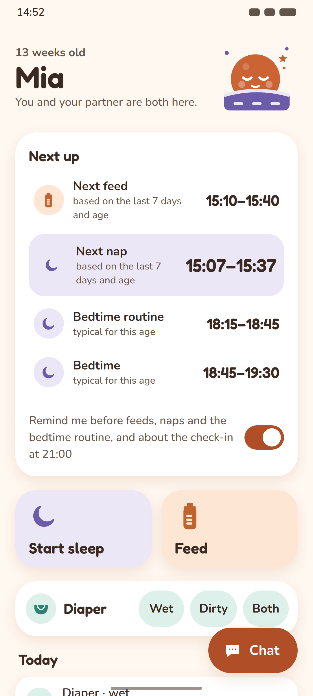</a>
<a href="a-apricot-moon/confirm-card-light.png">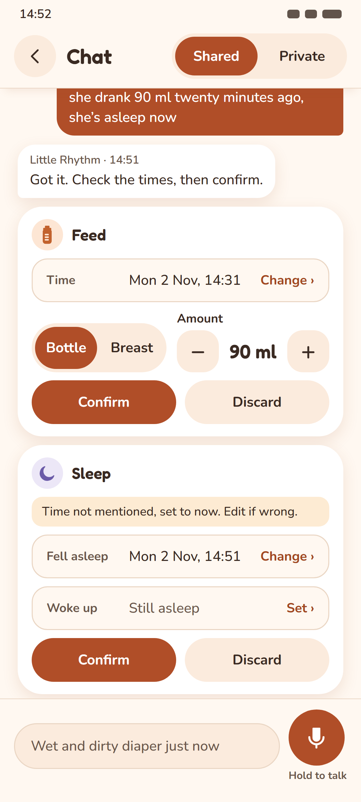</a>
<a href="a-apricot-moon/escalation-light.png">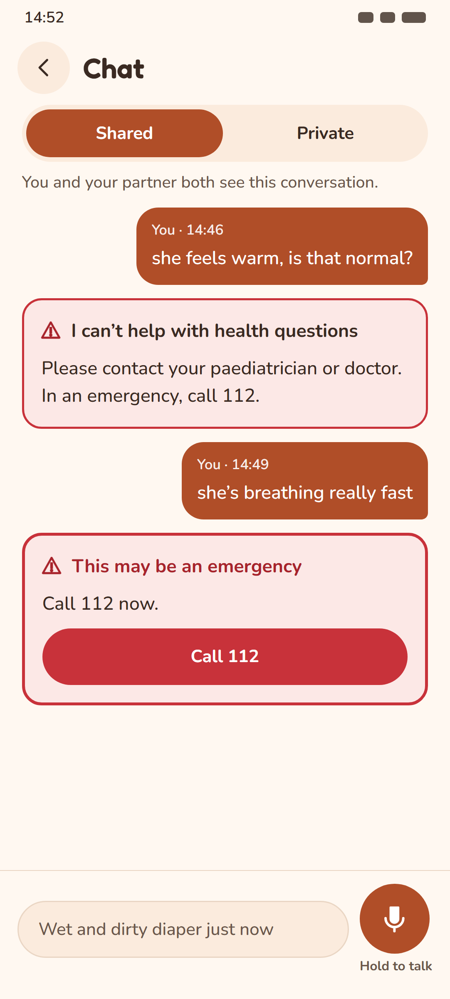</a>
<a href="a-apricot-moon/home-dark.png">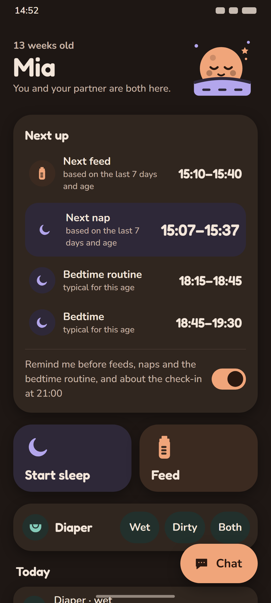</a>
<a href="a-apricot-moon/confirm-card-dark.png">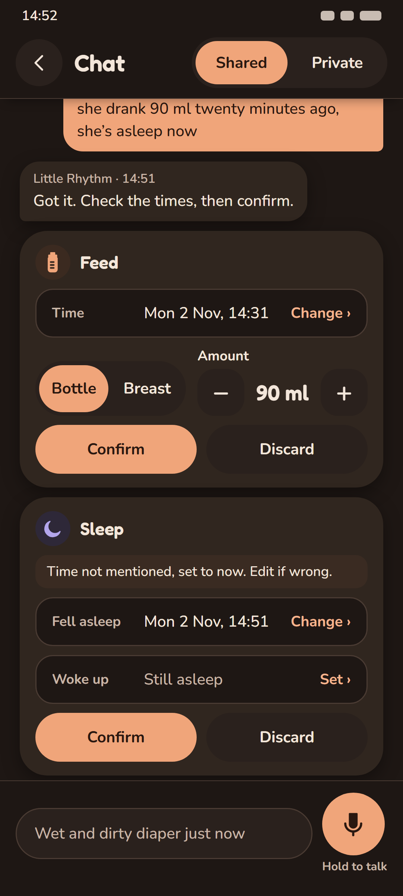</a>
<a href="a-apricot-moon/escalation-dark.png">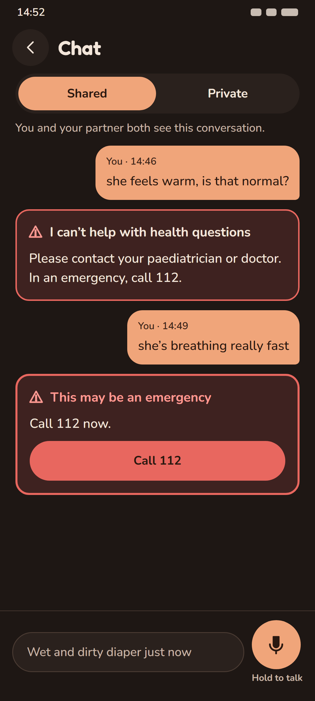</a>

**B. Sage Nest**

<a href="b-sage-nest/home-light.png">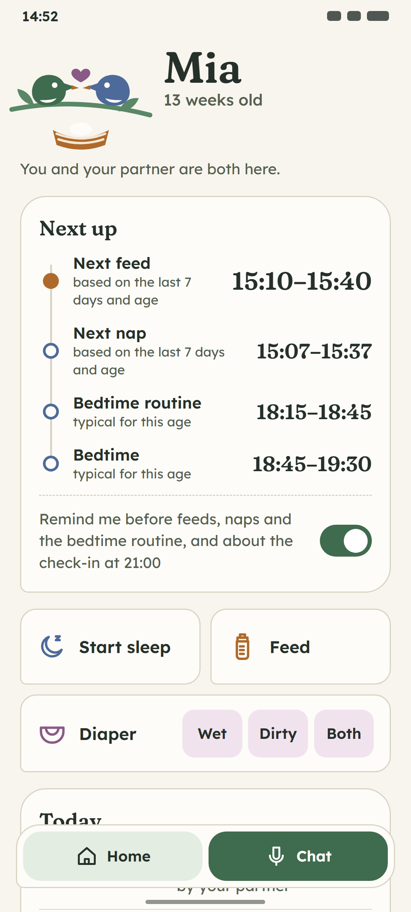</a>
<a href="b-sage-nest/confirm-card-light.png">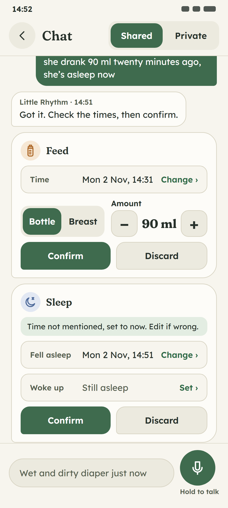</a>
<a href="b-sage-nest/escalation-light.png">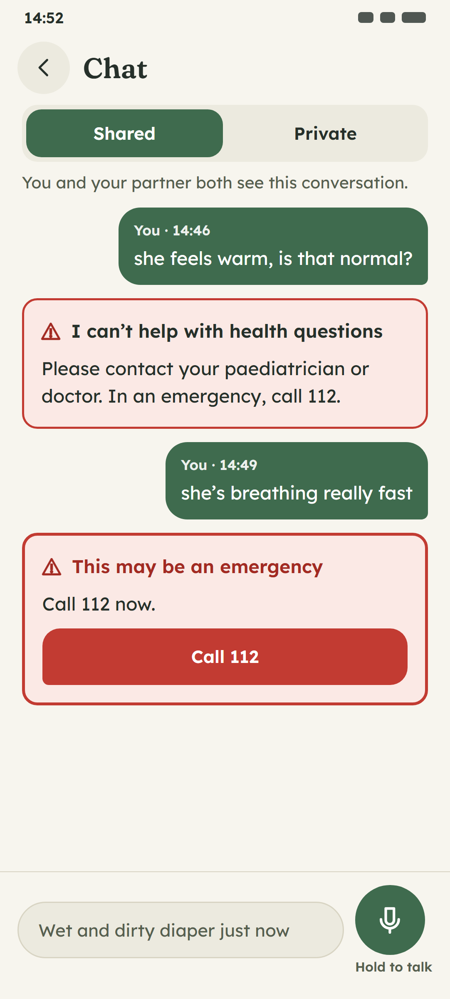</a>
<a href="b-sage-nest/home-dark.png">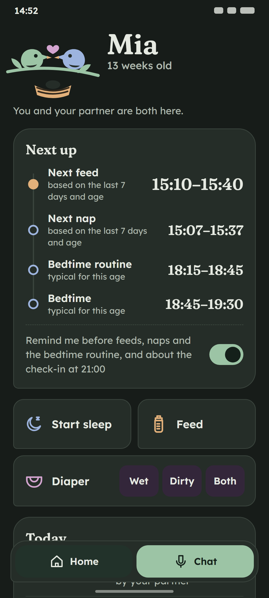</a>
<a href="b-sage-nest/confirm-card-dark.png">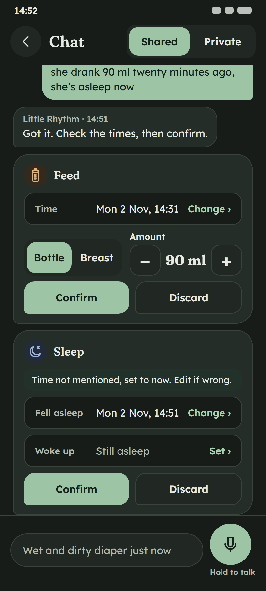</a>
<a href="b-sage-nest/escalation-dark.png">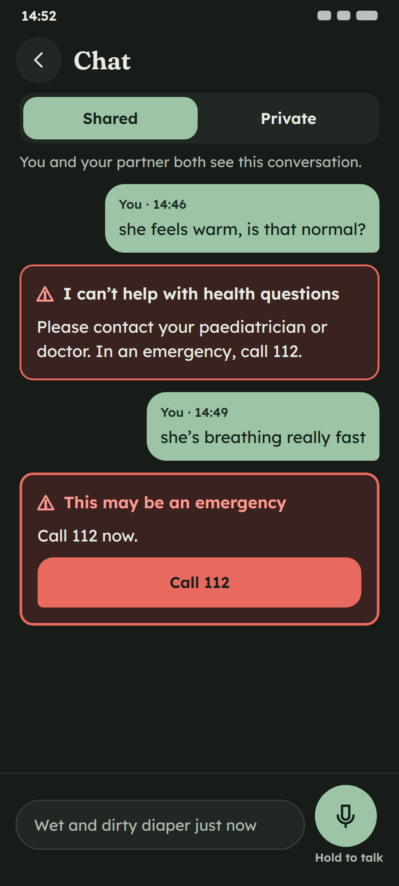</a>

**C. Cloud Lullaby**

<a href="c-cloud-lullaby/home-light.png">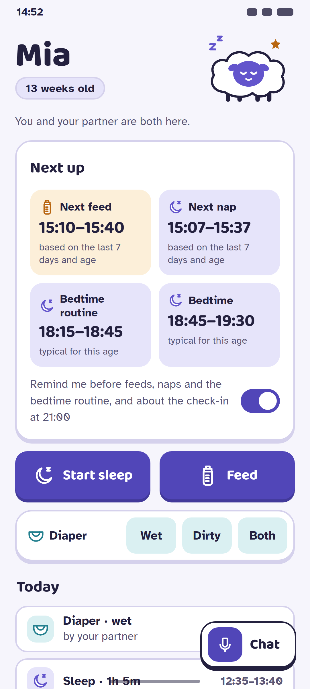</a>
<a href="c-cloud-lullaby/confirm-card-light.png">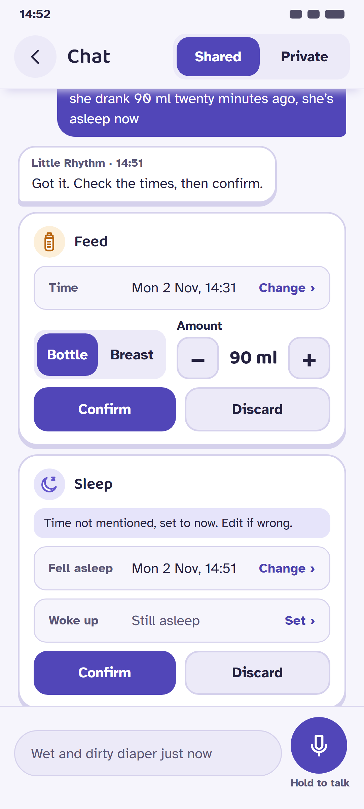</a>
<a href="c-cloud-lullaby/escalation-light.png">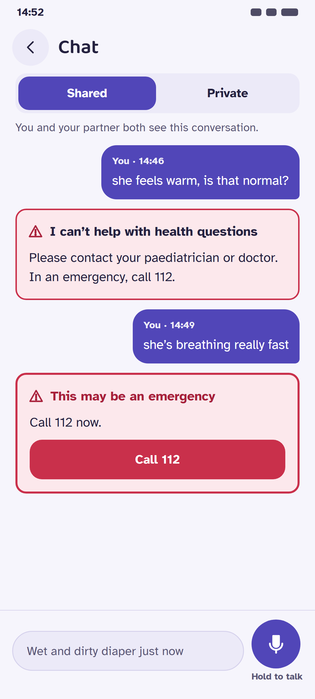</a>
<a href="c-cloud-lullaby/home-dark.png">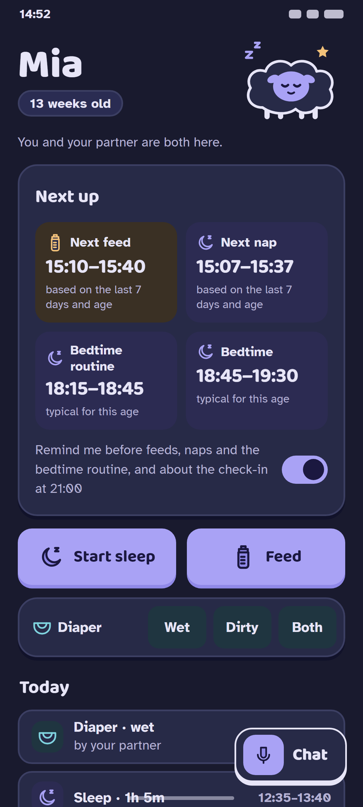</a>
<a href="c-cloud-lullaby/confirm-card-dark.png">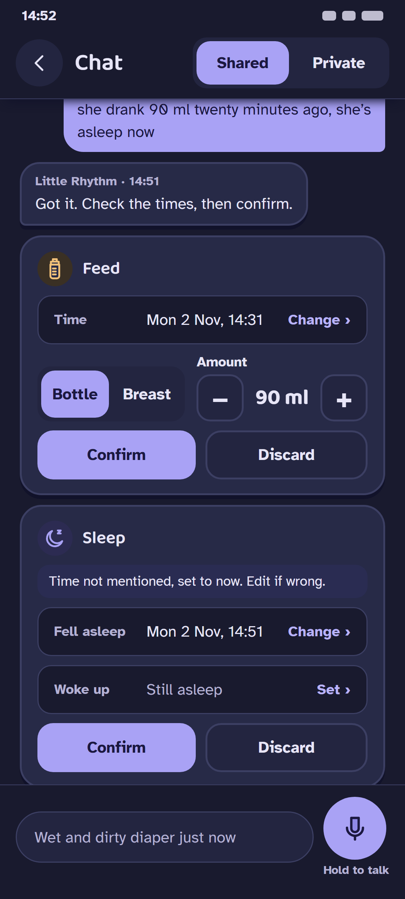</a>
<a href="c-cloud-lullaby/escalation-dark.png">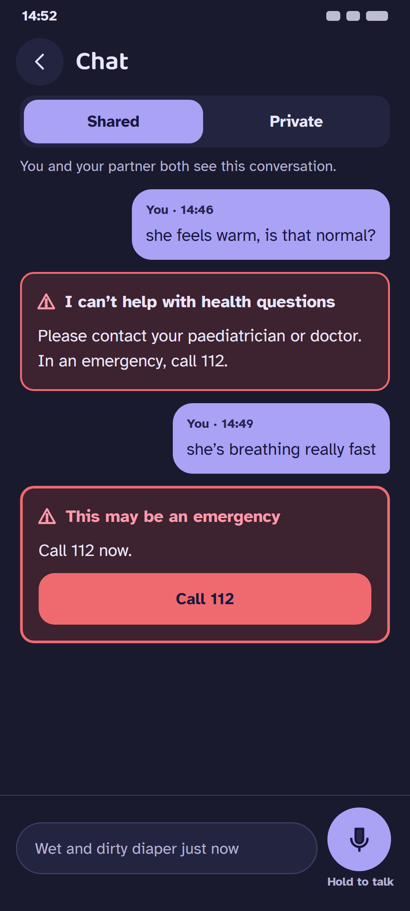</a>

## Recommendation: B. Sage Nest

1. **The escalation card stays the most serious.** This is a hard rule (no medical advice). In B the only red on screen
   is the escalation card, and green is red's complement, so the card stands out from everything around it. In A the
   parent's own burnt-orange bubbles sit next to it (`a-apricot-moon/escalation-light.png`).
2. **Calmest at 3 a.m.** Moss-dark pages, a flat surface with no shadows, and the smallest bright areas. C's dark mode
   has two full-width lavender buttons and lavender bubbles, which are the brightest things in any of the mockups.
3. **The mascot is the product.** Two birds, one nest: the two-parent idea (pairing, shared log, check-in, night-feed
   balance) in one picture. It can carry the couple layer later (both birds on the branch once both have checked in)
   without new copy.
4. **Readable for tired eyes.** Lexend body text at 15–17 sp, Fraunces only at 21 sp and up for names, titles and the
   times; event colours that differ in hue and lightness, with three distinct icon shapes.
5. **Warm without being childish.** The brief asks for playful visuals with adult copy. The serif and the leaf-cornered
   cards are friendly but still look like a tool two adults trust.

Worth borrowing:
- **From C:** the large Next up times. B's path layout could set the nearest window at C's 23–25 sp.
- **From A:** the soft-disc colour coding behind icons in the timeline. B already uses tinted squares in the confirm cards.

## Notes for implementation

- Start with `palette.ts`: same 16 token names plus 7 new ones (`card`, `feed`, `feedSoft`, `sleep`, `sleepSoft`,
  `diaper`, `diaperSoft`). Add the new pairs to `palette.test.ts` (listed in each README's contrast table).
- `expo-font` and `react-native-svg` are already in `app/package.json`. Fonts and the mascot need only assets and JS,
  not a new native module (confirm against the installed build before relying on it).
- Copy is unchanged. The layout changes (pinned chat header and composer, labels inside the confirm-card fields,
  "Sign out" and "Delete account" off the home screen) are listed in each README.
- To regenerate the mockups, run `node docs/design/tools/build.mjs` and then the headless Chrome command from the brief.
  `palettes.json` is the single source for every colour.
