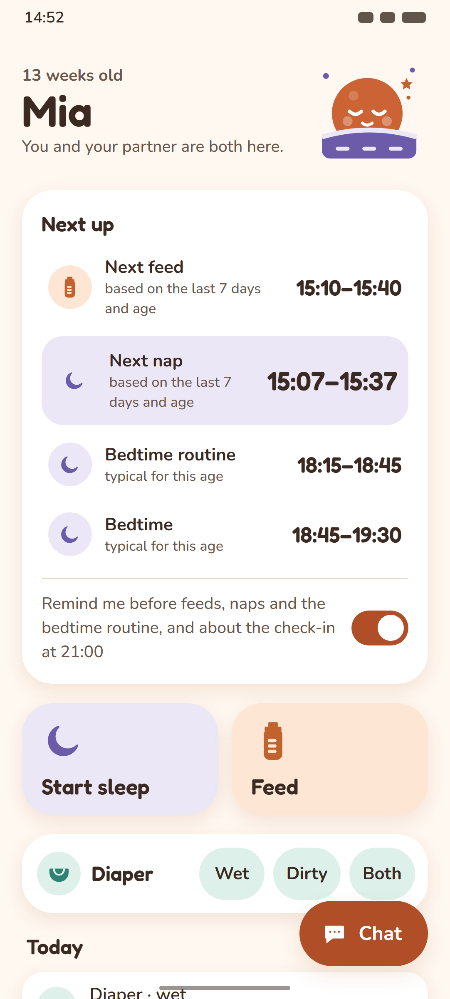
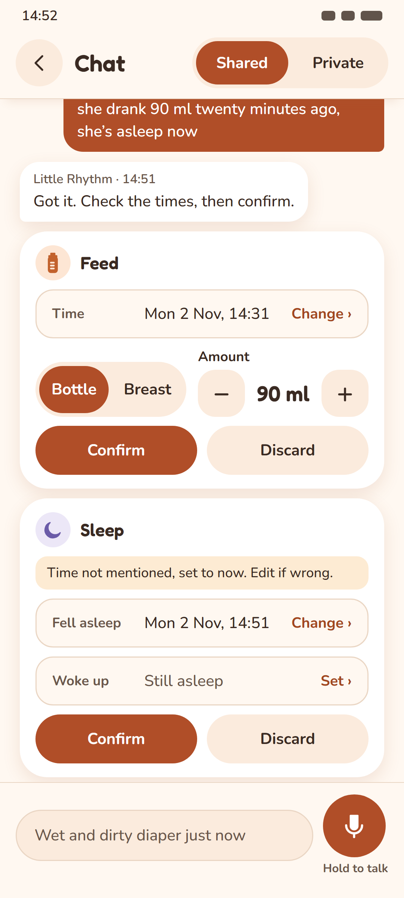
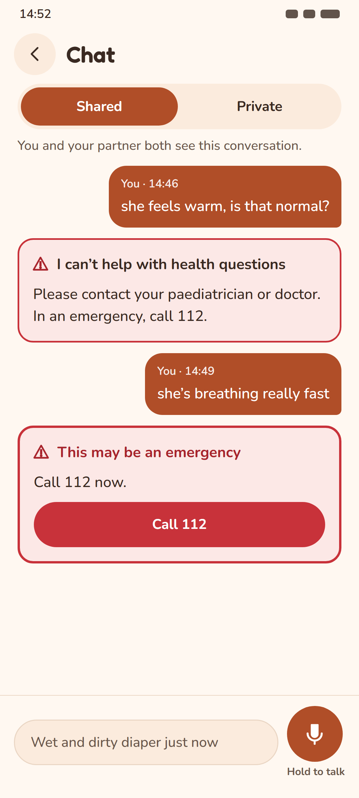
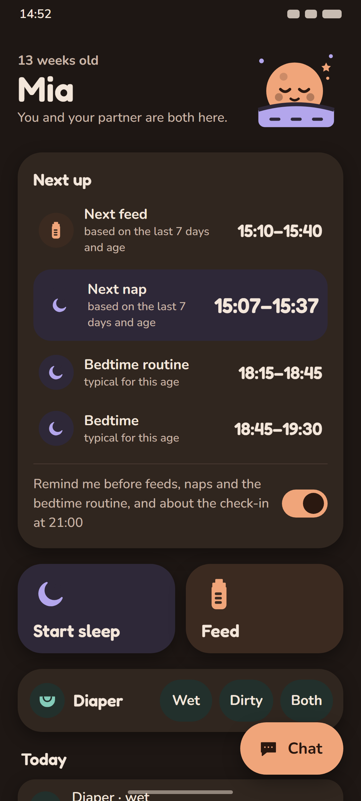
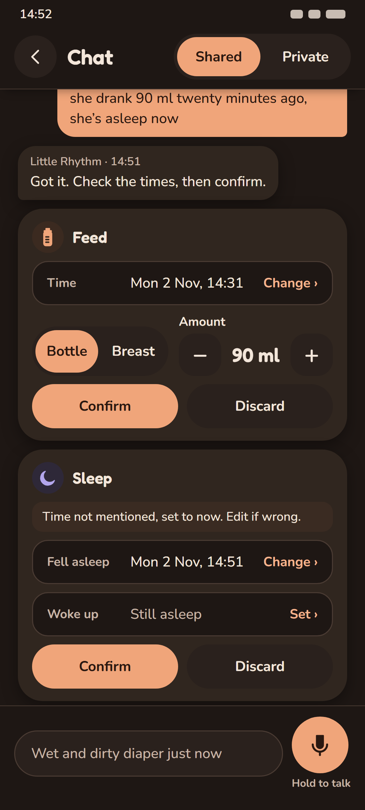
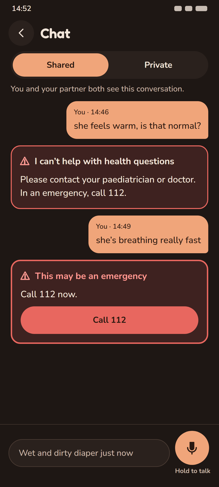
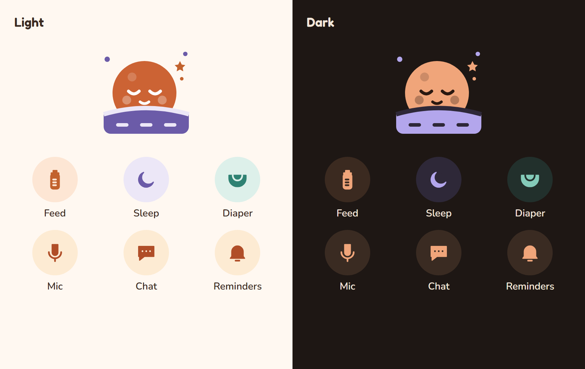

# A. Apricot Moon

A nursery lit by a salt lamp. Everything is warm, round and a little puffy: cream pages, white pillowy cards with
soft shadows, pill-shaped buttons, and a sleepy round moon named **Moonbean** tucked under a striped blanket in the header.
It is the most "baby app" of the three: cosy and instantly friendly. At night the page turns to warm cocoa, and the
apricot buttons get dark labels, so nothing on screen glows white.

| Home | Confirm cards | Escalation |
|---|---|---|
|  |  |  |
|  |  |  |

Each PNG is rendered from the `.html` file beside it (412×915 CSS px at 2.625×, 1082×2402 px; 412 × 2.625 = 1081.5, which Chrome rounds up). The icon and mascot sheet is `icons-mascot.png`.

## Palette

Hue family: warm apricot and cream, with dusky lavender for sleep and a soft teal for diapers. Dark mode is warm cocoa (#1E1714), not grey. The existing token names are kept, so the redesign starts as a change to `palette.ts` only. Seven tokens are new.

| Token | Light | Dark | Role |
|---|---|---|---|
| text | `#3A2A22` | `#F3E6DA` | Body text |
| textSecondary | `#6B574B` | `#C8B5A6` | Secondary text, basis lines |
| background | `#FFF8F1` | `#1E1714` | Page |
| surface | `#FBEBDD` | `#2A211D` | Fields, segment track, secondary buttons |
| card | `#FFFFFF` | `#30261F` | **New.** Cards and bubbles (elevated surface) |
| border | `#EAD6C4` | `#4A3B33` | Decorative dividers and outlines |
| primary | `#B04E28` | `#F0A57A` | Fills: buttons, selected segment, mic |
| primaryPressed | `#923E1F` | `#E08E60` | Pressed fill |
| onPrimary | `#FFFFFF` | `#2A1810` | Label on primary and on error |
| accent | `#CC6334` | `#F0A57A` | Highlights, mascot body, night-feed bar. Never text |
| link | `#A2461F` | `#F5B48E` | Text links ("Change ›") |
| focus | `#B04E28` | `#F0A57A` | Focused-field ring |
| infoBackground | `#FDEBD3` | `#3A2B22` | Info note ("Time not mentioned…"), selected nav item |
| success | `#3B8552` | `#7CC08F` | Icons only |
| error | `#C8323A` | `#E8675F` | Escalation border, "Call 112" fill, danger buttons |
| errorText | `#A8232B` | `#FF9A93` | Error messages, urgent escalation title |
| warningBackground | `#FCE8E6` | `#3E2220` | Escalation card only |
| feed | `#C2622D` | `#F0A57A` | **New.** Feed icon and marks (non-text) |
| feedSoft | `#FDE6D4` | `#3B2A20` | **New.** Feed chip and tile fill |
| sleep | `#6B5BA8` | `#B3A6EC` | **New.** Sleep icon and marks (non-text) |
| sleepSoft | `#ECE7F7` | `#2E2838` | **New.** Sleep chip and tile fill |
| diaper | `#2F8273` | `#84CBB9` | **New.** Diaper icon and marks (non-text) |
| diaperSoft | `#DDF0EA` | `#22302C` | **New.** Diaper chip fill |

- Dark mode flips the fill model: `primary` becomes a light apricot (#F0A57A) with a **dark** `onPrimary` (#2A1810).
  The biggest fills on screen (the Chat button, the selected segment, Confirm) are then mid-tone, not white-on-saturated,
  which cuts glare at 3 a.m.
- Risk: `primary` (#B04E28, burnt apricot) is the closest of the three directions to `error` (#C8323A). On the escalation
  screen the parent's own bubbles are nearly the escalation red (see `escalation-light.png`). If A is chosen, user
  bubbles should move to `feedSoft` with `text`, so red stays reserved for escalation.

### Contrast (WCAG 2.x, computed)

Computed by `docs/design/tools/contrast.mjs` (the same formula as `palette.test.ts`) from `docs/design/tools/palettes.json`. The first 23 rows are the pairs `palette.test.ts` checks today. The rest are pairs for the new tokens: text ≥ 4.5:1, icons, accents and boundaries ≥ 3:1. **Every pair passes in both themes.**

| Pair (fg on bg) | Min | Light | Dark |
|---|---|---|---|
| text on background | 4.5:1 | 13.00:1 | 14.43:1 |
| text on surface | 4.5:1 | 11.75:1 | 12.85:1 |
| text on border | 4.5:1 | 9.72:1 | 8.73:1 |
| text on infoBackground | 4.5:1 | 11.73:1 | 11.07:1 |
| text on warningBackground | 4.5:1 | 11.62:1 | 11.79:1 |
| textSecondary on background | 4.5:1 | 6.46:1 | 8.94:1 |
| textSecondary on surface | 4.5:1 | 5.83:1 | 7.96:1 |
| textSecondary on warningBackground | 4.5:1 | 5.77:1 | 7.30:1 |
| link on background | 4.5:1 | 5.81:1 | 9.94:1 |
| link on surface | 4.5:1 | 5.25:1 | 8.85:1 |
| onPrimary on primary | 4.5:1 | 5.29:1 | 8.38:1 |
| onPrimary on primaryPressed | 4.5:1 | 7.16:1 | 6.64:1 |
| onPrimary on error | 4.5:1 | 5.29:1 | 5.29:1 |
| errorText on background | 4.5:1 | 6.78:1 | 8.67:1 |
| errorText on surface | 4.5:1 | 6.13:1 | 7.72:1 |
| errorText on warningBackground | 4.5:1 | 6.06:1 | 7.08:1 |
| text on card | 4.5:1 | 13.69:1 | 12.05:1 |
| textSecondary on card | 4.5:1 | 6.80:1 | 7.46:1 |
| link on card | 4.5:1 | 6.12:1 | 8.30:1 |
| errorText on card | 4.5:1 | 7.14:1 | 7.24:1 |
| textSecondary on infoBackground | 4.5:1 | 5.83:1 | 6.86:1 |
| text on feedSoft | 4.5:1 | 11.37:1 | 11.15:1 |
| text on sleepSoft | 4.5:1 | 11.30:1 | 11.61:1 |
| text on diaperSoft | 4.5:1 | 11.55:1 | 11.22:1 |
| textSecondary on feedSoft | 4.5:1 | 5.65:1 | 6.90:1 |
| textSecondary on sleepSoft | 4.5:1 | 5.61:1 | 7.19:1 |
| textSecondary on diaperSoft | 4.5:1 | 5.74:1 | 6.95:1 |
| focus on background | 3:1 | 5.03:1 | 8.73:1 |
| focus on surface | 3:1 | 4.55:1 | 7.77:1 |
| accent on background | 3:1 | 3.69:1 | 8.73:1 |
| accent on surface | 3:1 | 3.34:1 | 7.77:1 |
| success on background | 3:1 | 4.28:1 | 8.24:1 |
| error on warningBackground | 3:1 | 4.49:1 | 4.49:1 |
| primary on background | 3:1 | 5.03:1 | 8.73:1 |
| focus on card | 3:1 | 5.29:1 | 7.29:1 |
| accent on card | 3:1 | 3.89:1 | 7.29:1 |
| primary on card | 3:1 | 5.29:1 | 7.29:1 |
| success on card | 3:1 | 4.50:1 | 6.88:1 |
| feed on background | 3:1 | 3.93:1 | 8.73:1 |
| feed on card | 3:1 | 4.13:1 | 7.29:1 |
| feed on feedSoft | 3:1 | 3.44:1 | 6.74:1 |
| sleep on background | 3:1 | 5.41:1 | 8.07:1 |
| sleep on card | 3:1 | 5.70:1 | 6.74:1 |
| sleep on sleepSoft | 3:1 | 4.70:1 | 6.49:1 |
| diaper on background | 3:1 | 4.37:1 | 9.45:1 |
| diaper on card | 3:1 | 4.60:1 | 7.89:1 |
| diaper on diaperSoft | 3:1 | 3.89:1 | 7.35:1 |

## Type

| Role | Font | Size / line height | Weight |
|---|---|---|---|
| Baby name | Fredoka | 40 / 44 | 600 |
| Card title ("Next up", "Today") | Fredoka | 19 / 26 | 600 |
| Next up times | Fredoka | 20 / 26 (next item 24) | 600 |
| Quick-log tile label | Fredoka | 20 / 26 | 600 |
| Body, chat text | Nunito | 17 / 25 | 500 |
| Small (labels, "by your partner") | Nunito | 15 / 22 | 500–700 |
| Caption (basis lines, message meta) | Nunito | 13 / 18 | 600 |
| Buttons | Nunito | 16 / 20 | 700 |

- **Fredoka**: OFL 1.1. Source: https://fonts.google.com/specimen/Fredoka, files at https://github.com/google/fonts/tree/main/ofl/fredoka
- **Nunito**: OFL 1.1. Source: https://fonts.google.com/specimen/Nunito, files at https://github.com/google/fonts/tree/main/ofl/nunito

Why it works at 3 a.m.: both are rounded sans with open counters and a large x-height. Fredoka's chunky digits make the
times the darkest thing on a card. Nunito's rounded terminals stay soft without the thin strokes of a geometric display
face. Body text goes up from 14 to 15–17 sp, and the smallest text (13 sp captions) holds only secondary information.

Licences were checked in the `google/fonts` repository: each family sits under `ofl/` and its `METADATA.pb` says `license: "OFL"` (SIL Open Font License 1.1). `expo-font` is already in `app/package.json`, so loading these needs only the font files, no new native module.

## Shape language

- Radii: cards 28, timeline rows 20, fields 18, buttons and segments fully round (pill).
- Elevation: a soft warm shadow (`0 6 18`, 14 % brown in light; 35 % black in dark). No borders on cards.
- Spacing: generous, 18 between blocks and 18 inside cards. Two big quick-log tiles (Start sleep, Feed) side by side,
  with the diaper chips on one row.
- Colour coding: each event type has a soft disc (`feedSoft` / `sleepSoft` / `diaperSoft`) behind its icon, used in Next
  up, quick log, the timeline and the confirm cards. The nearest Next up item gets a full `sleepSoft` or `feedSoft`
  row highlight instead of today's 4 px left bar.

## Icons

**Filled, soft-cornered silhouettes** on a matching soft disc: a bottle with measure marks, a crescent moon, a
diaper, a mic, a chat bubble with three dots, and a bell. Each is one solid shape in the event colour, with the inner
marks cut out in the disc colour. They are drawn on a 24-unit grid with 1.2-unit rounded joins, so they read at 22–40 dp.

## Mascot

**Moonbean**: a round, sleepy moon face (closed-arc eyes, small smile, soft cheeks) half tucked under a striped
lavender blanket, with two dots and a small star around it. It sits at the right of the home header and can doze in
empty states ("Nothing logged yet today"). Fills: `accent` (moon), `onPrimary` at 18–30 % (face, cheeks, craters),
`sleep` / `sleepSoft` (blanket), `feed` (star).

The SVG is `mascot.svg`. Every fill and stroke is a `var(--token)` that maps 1:1 to a theme token, so the react-native-svg port is a single `<Mascot />` component that reads `useTheme()`. There are no light and dark copies. The mascot never appears on the escalation card, in error states or near health text.

## Escalation card

It stays as it is today: `warningBackground` fill, a 2 px `error` border (3 px when urgent), the ⚠ mark in `errorText`, the fixed text from `escalation-card.tsx`, and a red `error` "Call 112" button with an `onPrimary` label. The direction changes only the font and the corner radius (18, the field radius, so it is less pillowy than A's 28 cards). It gets no shadow, no mascot, no icon and no tint from the event colours.

## Layout notes (no copy changes)

- Home order: header (age, name, "You and your partner are both here.", Moonbean) → Next up → quick-log tiles →
  diaper row → Today → check-in → night feeds. "Chat" becomes a floating pill button (bottom right). "Sign out" and
  "Delete account" move off home into a small account screen behind the header (one tap).
- Chat: the Shared / Private switch moves into a pinned header. The composer (field + 64 dp round mic, with "Hold to
  talk" under it) is pinned to the bottom. Bubbles: the parent's on the right in `primary`, Little Rhythm's on the left
  in `card`.
- Confirm cards: the type icon sits next to the title; the field labels ("Time", "Fell asleep", "Woke up") move inside the
  field, left of the value; Bottle / Breast and the Amount stepper share a row. The words are unchanged.
