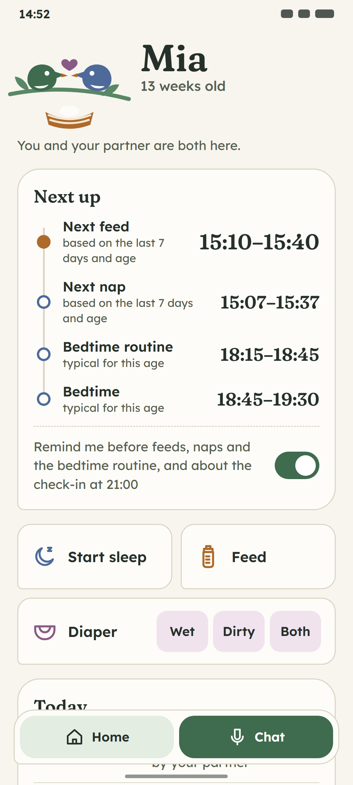
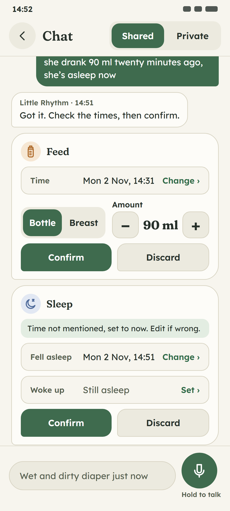
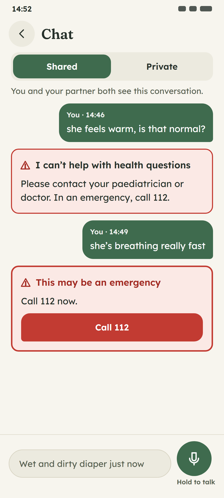
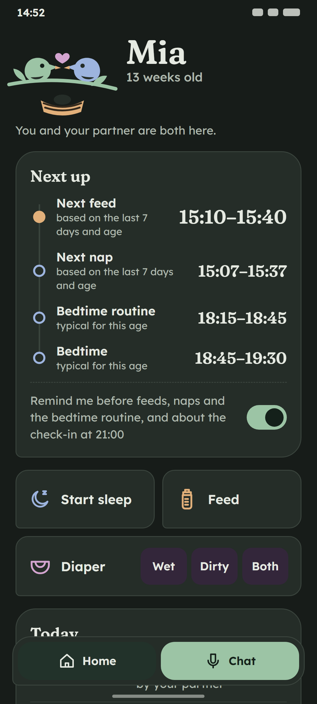
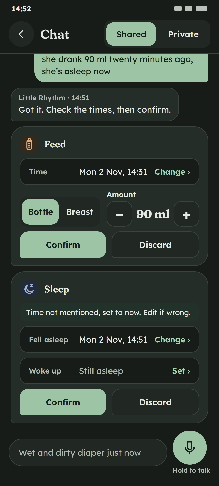
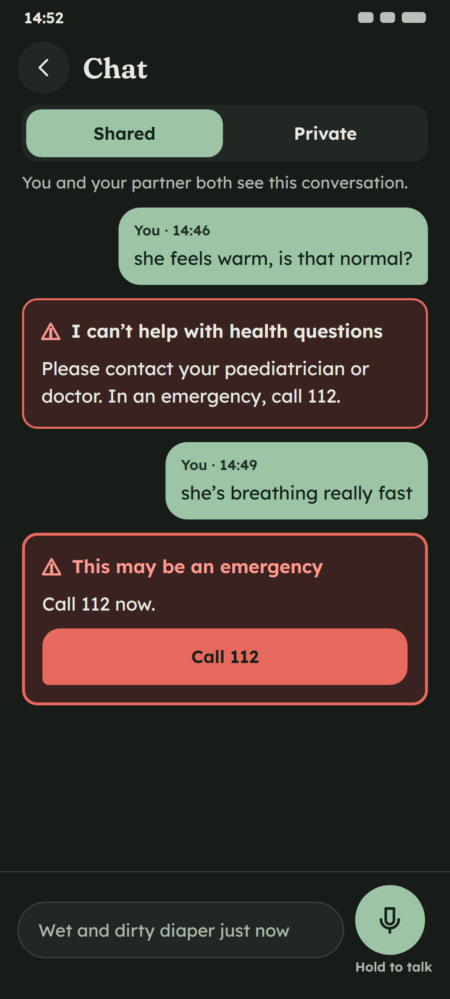
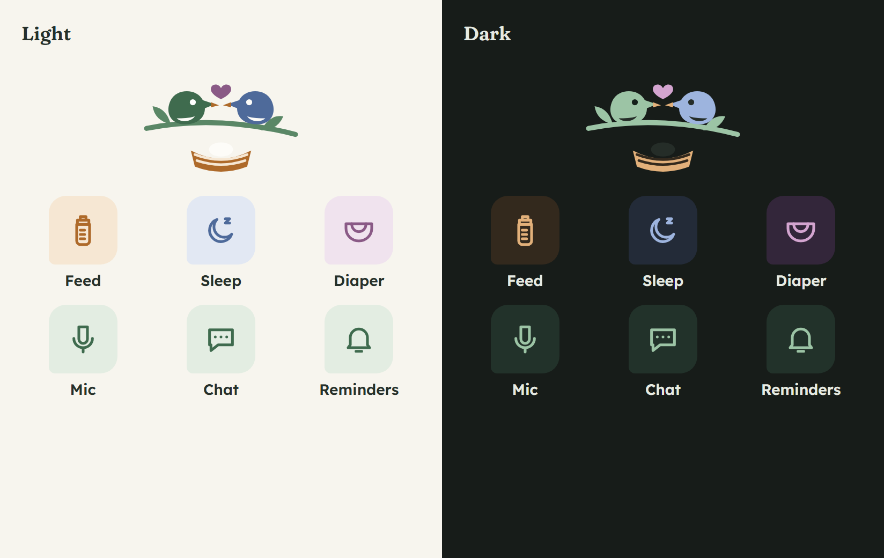

# B. Sage Nest

Calm, grown-up and natural: a linen notebook on a windowsill with a plant. Two little birds sit on a branch
over a nest. They are the two parents, which is what the app is about (two people, one baby, one rhythm). Cards are
flat, with a hairline border and one "leaf" corner (small bottom-left radius), so they look hand-cut rather than pillowy.
Headings are a soft serif, which keeps it warm without becoming cute. Green is the complement of red, so the
escalation card stands out more here than in either other direction. At night, moss-dark pages with pale-sage fills are
the lowest-glare palette of the three.

| Home | Confirm cards | Escalation |
|---|---|---|
|  |  |  |
|  |  |  |

Each PNG is rendered from the `.html` file beside it (412×915 CSS px at 2.625×, 1082×2402 px; 412 × 2.625 = 1081.5, which Chrome rounds up). The icon and mascot sheet is `icons-mascot.png`.

## Palette

Hue family: sage and forest green on oat linen, with honey for feeds, dusk blue for sleep and mauve for diapers. Dark mode is a deep moss (#171C19). The existing token names are kept, so the redesign starts as a change to `palette.ts` only. Seven tokens are new.

| Token | Light | Dark | Role |
|---|---|---|---|
| text | `#26302A` | `#E6EAE2` | Body text |
| textSecondary | `#56604F` | `#AEB8AD` | Secondary text, basis lines |
| background | `#F7F5EE` | `#171C19` | Page |
| surface | `#ECEADF` | `#212823` | Fields, segment track, secondary buttons |
| card | `#FDFCF8` | `#252D28` | **New.** Cards and bubbles (elevated surface) |
| border | `#D8D4C3` | `#3A443D` | Decorative dividers and outlines |
| primary | `#3F6B4E` | `#9CC4A5` | Fills: buttons, selected segment, mic |
| primaryPressed | `#31573E` | `#85B190` | Pressed fill |
| onPrimary | `#FFFFFF` | `#14201A` | Label on primary and on error |
| accent | `#5A8766` | `#9CC4A5` | Highlights, mascot body, night-feed bar. Never text |
| link | `#2F6A47` | `#A8D4B2` | Text links ("Change ›") |
| focus | `#3F6B4E` | `#9CC4A5` | Focused-field ring |
| infoBackground | `#E3EDE2` | `#22322A` | Info note ("Time not mentioned…"), selected nav item |
| success | `#3F7F4F` | `#8CC79A` | Icons only |
| error | `#C23B32` | `#E8695D` | Escalation border, "Call 112" fill, danger buttons |
| errorText | `#A32A22` | `#FF9C92` | Error messages, urgent escalation title |
| warningBackground | `#FBE9E5` | `#3A2220` | Escalation card only |
| feed | `#AE6A2A` | `#E2B07A` | **New.** Feed icon and marks (non-text) |
| feedSoft | `#F6E7D3` | `#33291D` | **New.** Feed chip and tile fill |
| sleep | `#4E6A9A` | `#9DB4DE` | **New.** Sleep icon and marks (non-text) |
| sleepSoft | `#E2E8F3` | `#232B38` | **New.** Sleep chip and tile fill |
| diaper | `#8A5A86` | `#D3A4CF` | **New.** Diaper icon and marks (non-text) |
| diaperSoft | `#F0E3EE` | `#33263A` | **New.** Diaper chip fill |

- Dark mode uses light-sage fills (#9CC4A5) with a dark `onPrimary` (#14201A), like A, so buttons are mid-tone at night.
- The event hues (honey, dusk blue, mauve) are muted and far apart in hue, so feed, sleep and diaper are told apart
  even by people with red-green colour vision deficiency (blue vs honey vs mauve), and the icons differ in shape too.
- `card` (#FDFCF8) is barely lighter than `background`. Cards are defined by the 1.5 px `border`, not by fill or shadow.

### Contrast (WCAG 2.x, computed)

Computed by `docs/design/tools/contrast.mjs` (the same formula as `palette.test.ts`) from `docs/design/tools/palettes.json`. The first 23 rows are the pairs `palette.test.ts` checks today. The rest are pairs for the new tokens: text ≥ 4.5:1, icons, accents and boundaries ≥ 3:1. **Every pair passes in both themes.**

| Pair (fg on bg) | Min | Light | Dark |
|---|---|---|---|
| text on background | 4.5:1 | 12.51:1 | 14.16:1 |
| text on surface | 4.5:1 | 11.31:1 | 12.38:1 |
| text on border | 4.5:1 | 9.18:1 | 8.31:1 |
| text on infoBackground | 4.5:1 | 11.36:1 | 11.06:1 |
| text on warningBackground | 4.5:1 | 11.63:1 | 12.05:1 |
| textSecondary on background | 4.5:1 | 6.05:1 | 8.43:1 |
| textSecondary on surface | 4.5:1 | 5.47:1 | 7.37:1 |
| textSecondary on warningBackground | 4.5:1 | 5.62:1 | 7.18:1 |
| link on background | 4.5:1 | 5.88:1 | 10.46:1 |
| link on surface | 4.5:1 | 5.32:1 | 9.14:1 |
| onPrimary on primary | 4.5:1 | 6.13:1 | 8.67:1 |
| onPrimary on primaryPressed | 4.5:1 | 8.19:1 | 6.94:1 |
| onPrimary on error | 4.5:1 | 5.30:1 | 5.28:1 |
| errorText on background | 4.5:1 | 6.61:1 | 8.57:1 |
| errorText on surface | 4.5:1 | 5.98:1 | 7.48:1 |
| errorText on warningBackground | 4.5:1 | 6.14:1 | 7.29:1 |
| text on card | 4.5:1 | 13.30:1 | 11.61:1 |
| textSecondary on card | 4.5:1 | 6.43:1 | 6.91:1 |
| link on card | 4.5:1 | 6.25:1 | 8.57:1 |
| errorText on card | 4.5:1 | 7.03:1 | 7.02:1 |
| textSecondary on infoBackground | 4.5:1 | 5.49:1 | 6.59:1 |
| text on feedSoft | 4.5:1 | 11.24:1 | 11.68:1 |
| text on sleepSoft | 4.5:1 | 11.09:1 | 11.69:1 |
| text on diaperSoft | 4.5:1 | 11.00:1 | 11.65:1 |
| textSecondary on feedSoft | 4.5:1 | 5.43:1 | 6.95:1 |
| textSecondary on sleepSoft | 4.5:1 | 5.37:1 | 6.96:1 |
| textSecondary on diaperSoft | 4.5:1 | 5.32:1 | 6.94:1 |
| focus on background | 3:1 | 5.62:1 | 8.92:1 |
| focus on surface | 3:1 | 5.08:1 | 7.79:1 |
| accent on background | 3:1 | 3.78:1 | 8.92:1 |
| accent on surface | 3:1 | 3.42:1 | 7.79:1 |
| success on background | 3:1 | 4.42:1 | 8.84:1 |
| error on warningBackground | 3:1 | 4.51:1 | 4.62:1 |
| primary on background | 3:1 | 5.62:1 | 8.92:1 |
| focus on card | 3:1 | 5.97:1 | 7.31:1 |
| accent on card | 3:1 | 4.02:1 | 7.31:1 |
| primary on card | 3:1 | 5.97:1 | 7.31:1 |
| success on card | 3:1 | 4.69:1 | 7.24:1 |
| feed on background | 3:1 | 3.93:1 | 8.82:1 |
| feed on card | 3:1 | 4.18:1 | 7.22:1 |
| feed on feedSoft | 3:1 | 3.53:1 | 7.27:1 |
| sleep on background | 3:1 | 5.00:1 | 8.23:1 |
| sleep on card | 3:1 | 5.31:1 | 6.75:1 |
| sleep on sleepSoft | 3:1 | 4.43:1 | 6.80:1 |
| diaper on background | 3:1 | 4.95:1 | 8.20:1 |
| diaper on card | 3:1 | 5.26:1 | 6.72:1 |
| diaper on diaperSoft | 3:1 | 4.35:1 | 6.75:1 |

## Type

| Role | Font | Size / line height | Weight |
|---|---|---|---|
| Baby name | Fraunces (SOFT 100) | 44 / 46 | 600 |
| Card title ("Next up", "Today", "Feed") | Fraunces | 21 / 28 | 600 |
| Next up times | Fraunces | 21 / 28 (next item 25) | 600 |
| Body, chat text | Lexend | 16–17 / 25 | 400–500 |
| Small (labels, toggle text) | Lexend | 15 / 22 | 500 |
| Caption (basis lines, meta) | Lexend | 13 / 18 | 500–600 |
| Buttons, quick-log labels | Lexend | 16–17 / 22 | 600 |

- **Fraunces**: OFL 1.1. Source: https://fonts.google.com/specimen/Fraunces, files at https://github.com/google/fonts/tree/main/ofl/fraunces (variable: opsz, wght, SOFT, WONK; ship static instances at SOFT 100, wght 600)
- **Lexend**: OFL 1.1. Source: https://fonts.google.com/specimen/Lexend, files at https://github.com/google/fonts/tree/main/ofl/lexend

Why it works at 3 a.m.: Lexend was designed to reduce visual stress, with wide letter spacing, generous width and
very distinct letterforms, so a tired eye takes in a word in one pass. Fraunces is used only at 21 sp and up, where its
soft, high-contrast serifs read cleanly. Its lining figures make the times look like a friendly clock, not a spreadsheet.

Licences were checked in the `google/fonts` repository: each family sits under `ofl/` and its `METADATA.pb` says `license: "OFL"` (SIL Open Font License 1.1). `expo-font` is already in `app/package.json`, so loading these needs only the font files, no new native module.

## Shape language

- Radii: cards `26 26 26 8` (one leaf corner, bottom-left), buttons `16 16 16 6`, fields and segments 14, rows 16.
- Elevation: none. Flat fills with a 1.5 px `border`, and a dashed divider above the reminder toggle. Calm, paper-like.
- Spacing: medium (16 between blocks). Next up is a vertical "path": a thin line links four nodes, each ringed in its
  event colour, with the next item's node filled. It reads as the shape of the day.
- Navigation: a two-item bottom bar (Home, and Chat in `primary` with a mic icon), so voice logging is always one tap away.

## Icons

**Line icons**: 1.9-unit stroke, round caps and joins, no fill. The same bottle, moon (with a small "z"), diaper,
mic, chat and bell shapes as the other directions, drawn as outlines in the event colour on a soft rounded square.
They match the serif's hand-drawn calm and stay crisp on the dark moss background.

## Mascot

**The Nest**: two round birds face each other on a leafy branch, with a small heart between them and a woven nest
below holding one egg. One bird is `primary` (sage), the other `sleep` (dusk blue); eyes are `onPrimary` and `card`,
beaks `feed`, the heart `diaper`, the branch and leaves `accent`, and the nest `feed` / `feedSoft`. It can carry the couple
layer: on the check-in card, the two birds can stand for "you" and "your partner" (both answered = both on the branch).

The SVG is `mascot.svg`. Every fill and stroke is a `var(--token)` that maps 1:1 to a theme token, so the react-native-svg port is a single `<Mascot />` component that reads `useTheme()`. There are no light and dark copies. The mascot never appears on the escalation card, in error states or near health text.

## Escalation card

It stays as it is today: `warningBackground` fill, a 2 px `error` border (3 px when urgent), the ⚠ mark in `errorText`, the fixed text from `escalation-card.tsx`, and a red `error` "Call 112" button with an `onPrimary` label. The direction changes only the font and the corner radius (14, the field radius, with no leaf corner: the leaf shape is reserved for friendly cards). It gets no shadow, no mascot, no icon and no tint from the event colours.

## Layout notes (no copy changes)

- Home order: header (the Nest, name, age, "You and your partner are both here.") → Next up path → quick log
  (Start sleep and Feed as two outlined tiles; a full-width diaper row with Wet / Dirty / Both) → Today (one card, rows
  ≥ 52 dp with time, icon and description) → check-in → night feeds. A bottom bar holds Home and Chat. "Sign out" and
  "Delete account" move to an account screen.
- Chat: pinned header with back, title and the Shared / Private switch; the composer is pinned to the bottom; the
  parent's bubbles are `primary` green on the right, Little Rhythm's are `card` with a border on the left.
- Confirm cards: the type icon on a soft square sits next to the serif title. Labels move inside the fields and the
  stepper shares a row with Bottle / Breast. The words are unchanged.
