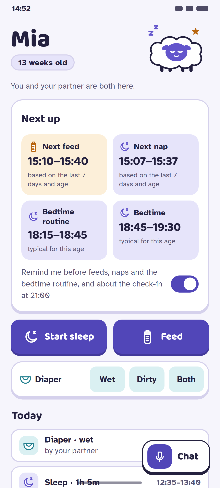
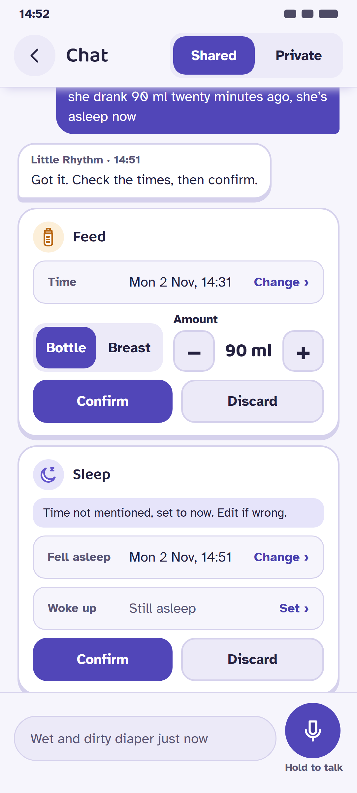
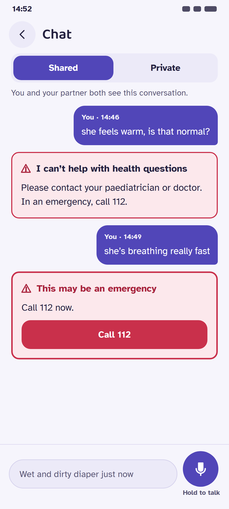
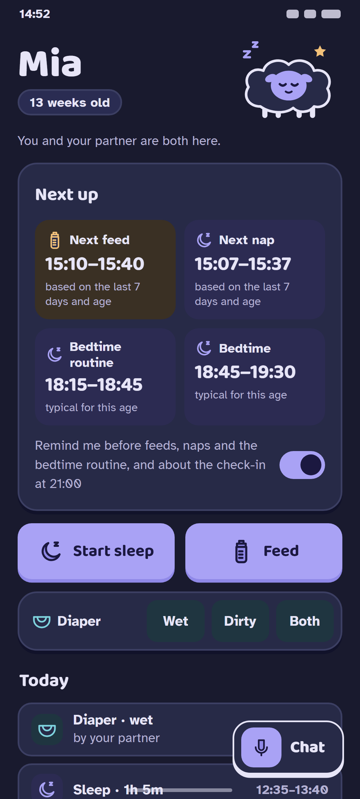
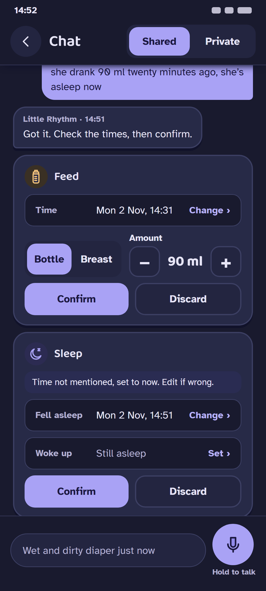
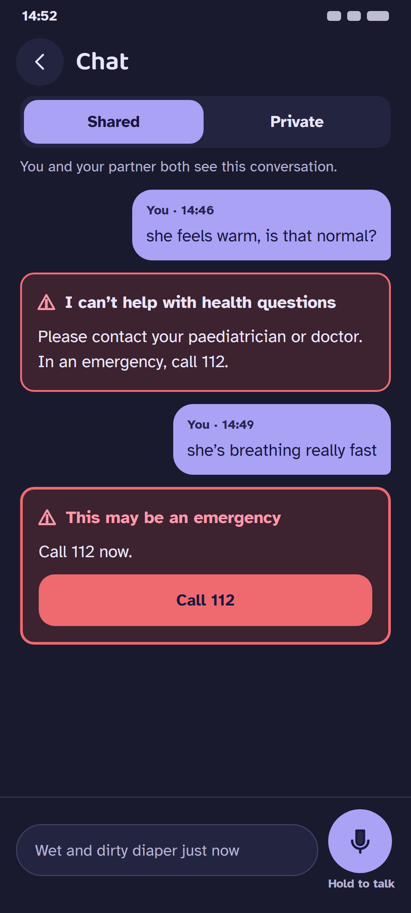
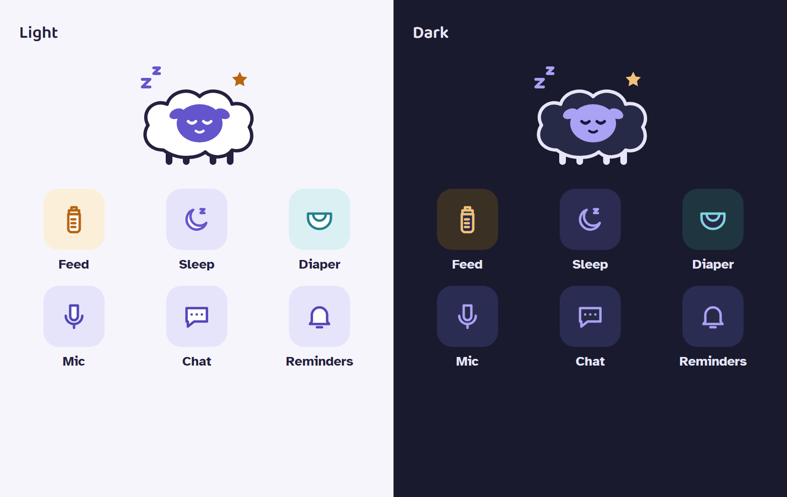

# C. Cloud Lullaby

Playful and bold, like a picture book. Cards look like stickers: a 2 px outline and a hard 4 px drop "shelf"
instead of a blur. The big actions are chunky indigo buttons that look pressable, and **Fluff**, a small cloud-sheep
dozing among "z"s and a star, sits in the header. This is the most energetic of the three and the easiest to recognise in a
demo video or an X post. Dark mode is a night sky rather than black, with lavender fills.

| Home | Confirm cards | Escalation |
|---|---|---|
|  |  |  |
|  |  |  |

Each PNG is rendered from the `.html` file beside it (412×915 CSS px at 2.625×, 1082×2402 px; 412 × 2.625 = 1081.5, which Chrome rounds up). The icon and mascot sheet is `icons-mascot.png`.

## Palette

Hue family: periwinkle and indigo on lilac-white, with marigold for feeds, indigo for sleep and aqua for diapers. Dark mode is a deep night-sky navy (#191A2E). The existing token names are kept, so the redesign starts as a change to `palette.ts` only. Seven tokens are new.

| Token | Light | Dark | Role |
|---|---|---|---|
| text | `#24213F` | `#E7E5F7` | Body text |
| textSecondary | `#5A5676` | `#B4B1D3` | Secondary text, basis lines |
| background | `#F6F5FC` | `#191A2E` | Page |
| surface | `#ECEAF8` | `#232540` | Fields, segment track, secondary buttons |
| card | `#FFFFFF` | `#272A47` | **New.** Cards and bubbles (elevated surface) |
| border | `#D5D1EC` | `#3C3F63` | Decorative dividers and outlines |
| primary | `#5146B8` | `#A9A2F5` | Fills: buttons, selected segment, mic |
| primaryPressed | `#42399A` | `#9089E8` | Pressed fill |
| onPrimary | `#FFFFFF` | `#1B1840` | Label on primary and on error |
| accent | `#7066D8` | `#A9A2F5` | Highlights, mascot body, night-feed bar. Never text |
| link | `#4A40AE` | `#B9B3FA` | Text links ("Change ›") |
| focus | `#5146B8` | `#A9A2F5` | Focused-field ring |
| infoBackground | `#E6E4FA` | `#2A2C52` | Info note ("Time not mentioned…"), selected nav item |
| success | `#2F8A5E` | `#7FD1A4` | Icons only |
| error | `#C9304B` | `#EE6A6F` | Escalation border, "Call 112" fill, danger buttons |
| errorText | `#A8203A` | `#FF9AAA` | Error messages, urgent escalation title |
| warningBackground | `#FCE8EC` | `#3D2230` | Escalation card only |
| feed | `#B8650F` | `#F2C179` | **New.** Feed icon and marks (non-text) |
| feedSoft | `#FCEFD9` | `#3A3024` | **New.** Feed chip and tile fill |
| sleep | `#6355CC` | `#A9A2F5` | **New.** Sleep icon and marks (non-text) |
| sleepSoft | `#E6E4FA` | `#2C2B52` | **New.** Sleep chip and tile fill |
| diaper | `#23808F` | `#7FD3DE` | **New.** Diaper icon and marks (non-text) |
| diaperSoft | `#DAF0F2` | `#1F3540` | **New.** Diaper chip fill |

- Dark mode again uses light fills (#A9A2F5) with a dark `onPrimary` (#1B1840). Here they are the **largest** light areas
  of the three directions (two full-width quick-log buttons plus the user bubbles), so C has the most glare at night. If
  chosen, dark-mode quick-log buttons could switch to `card` with a `primary` outline.
- `sleep` and `primary` share the indigo hue, so sleep is the "home" colour; feed (marigold) and diaper (aqua) contrast
  with it.

### Contrast (WCAG 2.x, computed)

Computed by `docs/design/tools/contrast.mjs` (the same formula as `palette.test.ts`) from `docs/design/tools/palettes.json`. The first 23 rows are the pairs `palette.test.ts` checks today. The rest are pairs for the new tokens: text ≥ 4.5:1, icons, accents and boundaries ≥ 3:1. **Every pair passes in both themes.**

| Pair (fg on bg) | Min | Light | Dark |
|---|---|---|---|
| text on background | 4.5:1 | 14.21:1 | 13.80:1 |
| text on surface | 4.5:1 | 12.97:1 | 12.02:1 |
| text on border | 4.5:1 | 10.38:1 | 8.14:1 |
| text on infoBackground | 4.5:1 | 12.34:1 | 10.72:1 |
| text on warningBackground | 4.5:1 | 13.11:1 | 11.53:1 |
| textSecondary on background | 4.5:1 | 6.40:1 | 8.28:1 |
| textSecondary on surface | 4.5:1 | 5.84:1 | 7.21:1 |
| textSecondary on warningBackground | 4.5:1 | 5.91:1 | 6.92:1 |
| link on background | 4.5:1 | 7.35:1 | 8.87:1 |
| link on surface | 4.5:1 | 6.71:1 | 7.72:1 |
| onPrimary on primary | 4.5:1 | 7.20:1 | 7.33:1 |
| onPrimary on primaryPressed | 4.5:1 | 9.20:1 | 5.54:1 |
| onPrimary on error | 4.5:1 | 5.24:1 | 5.54:1 |
| errorText on background | 4.5:1 | 6.61:1 | 8.51:1 |
| errorText on surface | 4.5:1 | 6.03:1 | 7.41:1 |
| errorText on warningBackground | 4.5:1 | 6.10:1 | 7.11:1 |
| text on card | 4.5:1 | 15.39:1 | 11.24:1 |
| textSecondary on card | 4.5:1 | 6.94:1 | 6.74:1 |
| link on card | 4.5:1 | 7.97:1 | 7.22:1 |
| errorText on card | 4.5:1 | 7.16:1 | 6.93:1 |
| textSecondary on infoBackground | 4.5:1 | 5.56:1 | 6.43:1 |
| text on feedSoft | 4.5:1 | 13.55:1 | 10.41:1 |
| text on sleepSoft | 4.5:1 | 12.34:1 | 10.76:1 |
| text on diaperSoft | 4.5:1 | 12.99:1 | 10.32:1 |
| textSecondary on feedSoft | 4.5:1 | 6.11:1 | 6.25:1 |
| textSecondary on sleepSoft | 4.5:1 | 5.56:1 | 6.46:1 |
| textSecondary on diaperSoft | 4.5:1 | 5.86:1 | 6.20:1 |
| focus on background | 3:1 | 6.64:1 | 7.47:1 |
| focus on surface | 3:1 | 6.06:1 | 6.51:1 |
| accent on background | 3:1 | 4.23:1 | 7.47:1 |
| accent on surface | 3:1 | 3.86:1 | 6.51:1 |
| success on background | 3:1 | 3.94:1 | 9.41:1 |
| error on warningBackground | 3:1 | 4.46:1 | 4.71:1 |
| primary on background | 3:1 | 6.64:1 | 7.47:1 |
| focus on card | 3:1 | 7.20:1 | 6.08:1 |
| accent on card | 3:1 | 4.58:1 | 6.08:1 |
| primary on card | 3:1 | 7.20:1 | 6.08:1 |
| success on card | 3:1 | 4.27:1 | 7.66:1 |
| feed on background | 3:1 | 3.95:1 | 10.32:1 |
| feed on card | 3:1 | 4.28:1 | 8.41:1 |
| feed on feedSoft | 3:1 | 3.77:1 | 7.79:1 |
| sleep on background | 3:1 | 5.24:1 | 7.47:1 |
| sleep on card | 3:1 | 5.67:1 | 6.08:1 |
| sleep on sleepSoft | 3:1 | 4.55:1 | 5.83:1 |
| diaper on background | 3:1 | 4.26:1 | 9.99:1 |
| diaper on card | 3:1 | 4.61:1 | 8.14:1 |
| diaper on diaperSoft | 3:1 | 3.89:1 | 7.48:1 |

## Type

| Role | Font | Size / line height | Weight |
|---|---|---|---|
| Baby name | Baloo 2 | 46 / 48 | 800 |
| Card title | Baloo 2 | 21 / 28 | 700 |
| Next up times | Baloo 2 | 23 / 30 | 700 |
| Quick-log buttons | Baloo 2 | 19 / 24 | 700 |
| Body, chat text | Atkinson Hyperlegible | 16–17 / 25 | 400 |
| Small (labels) | Atkinson Hyperlegible | 15 / 22 | 400–700 |
| Caption (basis lines, meta) | Atkinson Hyperlegible | 13 / 17 | 700 |

- **Baloo 2**: OFL 1.1. Source: https://fonts.google.com/specimen/Baloo+2, files at https://github.com/google/fonts/tree/main/ofl/baloo2
- **Atkinson Hyperlegible**: OFL 1.1 (the Google Fonts release). Source: https://fonts.google.com/specimen/Atkinson+Hyperlegible, files at https://github.com/google/fonts/tree/main/ofl/atkinsonhyperlegible

Why it works at 3 a.m.: Atkinson Hyperlegible was designed by the Braille Institute for low-vision readers. Every
easily confused character is drawn differently (I/l/1, O/0), so a half-awake parent won't misread "10" as
"1O". Its zero carries a slash, which shows in body text such as "21:00" in the mockups; the big Next up times are
set in Baloo 2, which has plain round digits. Baloo 2 is heavy and round, so the times and the name read from arm's length.

Licences were checked in the `google/fonts` repository: each family sits under `ofl/` and its `METADATA.pb` says `license: "OFL"` (SIL Open Font License 1.1). `expo-font` is already in `app/package.json`, so loading these needs only the font files, no new native module.

## Shape language

- Radii: cards 22, buttons and fields 14–16, rows 16; the Chat button is a rounded square (20).
- Elevation: "sticker" style. A 2 px `border` outline plus a hard `0 4 0` shadow in a darker tint (`#D5D1EC` light,
  `#11122A` dark; primary buttons use `primaryPressed` for their shelf), so things look physically pressable. No blur.
- Spacing: compact and grid-based. Next up is a 2×2 grid of tiles with large times (feed and nap tinted with their event
  colour), quick log is two big filled buttons, and the diaper row is one outlined strip.

## Icons

**Duotone**: a 1.9-unit outline in the event colour, filled with `card` (or `primaryPressed` on filled buttons), so
each icon looks like a little cut-out sticker that matches the cards. The shapes are the same family as A and B (bottle,
moon with "z", diaper, mic, chat, bell).

## Mascot

**Fluff**: a cloud that is also a sheep. It has a puffy `card` body with a `text` outline (sticker style), an indigo
(`sleep`) face with closed eyes and a small smile in `onPrimary`, four stubby `text` legs, "z z" in `sleep` and a `feed`
star. In dark mode the outline and legs turn light, so Fluff glows softly against the night sky with no second asset.

The SVG is `mascot.svg`. Every fill and stroke is a `var(--token)` that maps 1:1 to a theme token, so the react-native-svg port is a single `<Mascot />` component that reads `useTheme()`. There are no light and dark copies. The mascot never appears on the escalation card, in error states or near health text.

## Escalation card

It stays as it is today: `warningBackground` fill, a 2 px `error` border (3 px when urgent), the ⚠ mark in `errorText`, the fixed text from `escalation-card.tsx`, and a red `error` "Call 112" button with an `onPrimary` label. The direction changes only the font and the corner radius (14, the field radius; the escalation card drops the sticker shelf (no hard shadow) so it never looks playful). It gets no shadow, no mascot, no icon and no tint from the event colours.

## Layout notes (no copy changes)

- Home order: header (name, the age in a pill, Fluff) → "You and your partner are both here." → Next up 2×2 grid
  plus the reminder toggle → Start sleep / Feed buttons → diaper strip → Today → check-in → night feeds. "Chat" is a
  floating sticker button with a mic square. "Sign out" and "Delete account" move to an account screen.
- Chat: pinned header with back, title and the Shared / Private switch; the composer is pinned to the bottom; the
  parent's bubbles are `primary` on the right, Little Rhythm's are outlined `card` stickers on the left.
- Confirm cards: the type icon on a tinted rounded square next to the title, labels inside the fields, and the stepper on
  the Bottle / Breast row. The words are unchanged.
