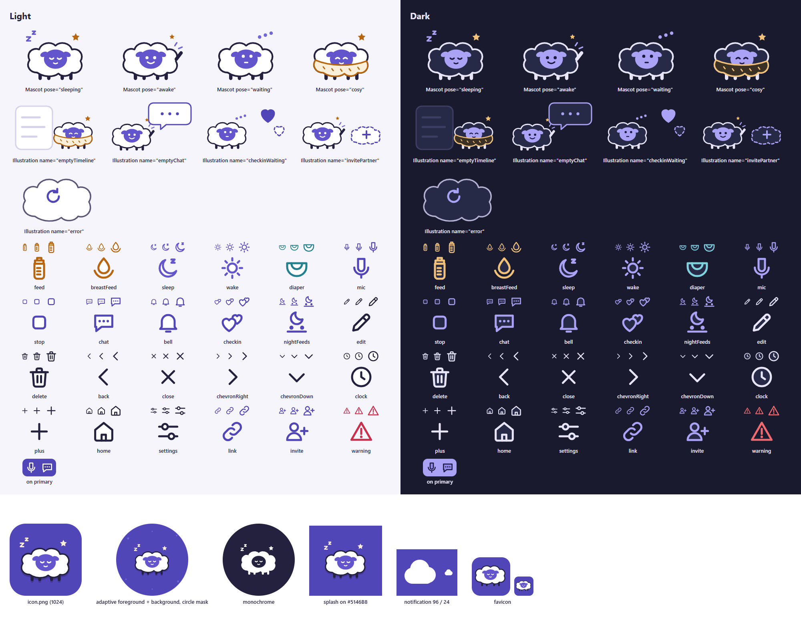

# Illustrations and icons

v1.1.0, direction C (Cloud Lullaby). Every illustration and icon in the app is an original
react-native-svg component; the native assets (app icon, adaptive icon, splash, notification icon,
favicon) are PNGs rendered from master SVGs.



The contact sheet is rendered from the same data the app draws (`art-data.ts`), so it shows the
geometry that ships. Icons appear at 20, 24 and 32 dp, then enlarged to 64.

## Components

All live in `app/src/components/illustrations/` and are exported from its `index.ts`:

```tsx
import { Icon, Illustration, Mascot } from '@/components/illustrations';
```

| Component | Props | Use |
|---|---|---|
| `Mascot` | `pose?: 'sleeping' \| 'awake' \| 'waiting' \| 'cosy'` (default `sleeping`), `size?` (width in dp, default 120; height = size × 0.8), `accessibilityLabel?` | `sleeping`: home header. `awake` (waving): welcome, onboarding, sign-in. `waiting`: check-in waiting for the partner, pairing waiting. `cosy` (under a blanket): empty states |
| `Illustration` | `name: 'emptyTimeline' \| 'emptyChat' \| 'checkinWaiting' \| 'invitePartner' \| 'error'`, `size?` (width, default 220; height = size × 140/220), `accessibilityLabel?` | Empty timeline, empty chat thread, check-in waiting, no partner yet / invite, generic error (calm, no mascot) |
| `Icon` | `name: IconName`, `size?` (default 24), `color?: ThemeColor` (outline; default the icon's tone), `fill?: ThemeColor` (duotone fill; default `card`), `accessibilityLabel?` | See the list below |

`IconName`: `feed`, `breastFeed`, `sleep`, `wake`, `diaper`, `mic`, `stop` (recording), `chat`, `bell`,
`checkin`, `nightFeeds`, `edit`, `delete`, `back`, `close`, `chevronRight`, `chevronDown`, `clock`,
`plus`, `home`, `settings`, `link`, `invite`, `warning`. `ICON_NAMES` lists them.

## Token mapping

Colours come only from `useTheme()`; one file per asset, no light/dark copies.

| Part | Token |
|---|---|
| Icon outline (default tone) | `feed` (feed, breastFeed), `sleep` (sleep, wake), `diaper`, `primary` (mic, stop, chat, bell, checkin, nightFeeds, link, invite), `text` (edit, delete, back, close, chevrons, clock, plus, home, settings), `error` (warning) |
| Icon duotone fill | `card` by default. On a filled `primary` button: `color="onPrimary" fill="primaryPressed"`. On the dark-mode tinted quick-log buttons: `color="primaryTintIcon" fill="primaryTintPressed"` (both themes) |
| Outline-only icons (no fill) | `back`, `close`, `chevronRight`, `chevronDown`, `plus`, `link`, `warning` |
| Fluff body / outline and legs | `card` / `text` (in dark mode the outline turns light, so Fluff glows on the night sky) |
| Fluff face and ears / eyes and mouth | `sleep` / `onPrimary` |
| Star, "z z", wave marks, waiting dots | `feed`, `sleep`, `accent`, `accent` |
| Cosy blanket | `feedSoft` fill, `feed` outline |
| Scene props | log card `card` + `border`; chat bubble `card` + `primary`; hearts `primary` (answered) and dashed `primary` (waiting); invite cloud dashed `primary`; error cloud `card` + `textSecondary`, retry arrow `primary` |

Stroke widths: icons 1.9 units on a 24-unit grid, round caps and joins. Fluff 3.5 (body), 7 (legs).

## Accessibility and placement rules

- Decorative by default: `accessible={false}` and `importantForAccessibility="no-hide-descendants"`.
  Pass `accessibilityLabel` only when the artwork carries meaning on its own; it then becomes one
  element with role `image`. An icon inside a labelled button stays decorative.
- Icons are not touch targets: the button around them gives the 48 dp target.
- `warning` is for the escalation card only: a plain `error` outline, no duotone fill, no playfulness.
- Fluff and the scenes never appear on the escalation card, in error states (the `error` scene has no
  mascot) or next to health text.
- Only `Path` and `G` from react-native-svg; no `SvgUri`, `SvgXml`, `LocalSvg` or remote `href`s.

## Native assets

Masters are in `app/assets/source/` (hex values from the light palette; each file's comment maps hex
to token). PNGs in `app/assets/images/` keep the sizes Expo already used:

| Master | PNG | Size | Notes |
|---|---|---|---|
| `icon.svg` | `icon.png` | 1024² | Fluff on `primary` with a `primaryPressed` shelf |
| `android-icon-foreground.svg` | `android-icon-foreground.png` | 512² | Transparent; artwork inside the central 66% circle |
| `android-icon-background.svg` | `android-icon-background.png` | 512² | `primary` with a few `accent` dots |
| `android-icon-monochrome.svg` | `android-icon-monochrome.png` | 432² | White + alpha, face cut out (themed icons) |
| `splash-icon.svg` | `splash-icon.png` | 228×213 | Transparent, on the splash background |
| `notification-icon.svg` | `notification-icon.png` | 96² | Pure white + alpha, solid cloud silhouette (no face, no cut-outs; the Fluff version read as an eye at 24 dp). Reaches a device only with the next native build |
| `favicon.svg` | `favicon.png` | 48² | Fluff on a `primary` rounded square |

`app/app.json`: splash `backgroundColor`, adaptive-icon `backgroundColor` and the expo-notifications
`color` are all `#5146B8` (light `primary`). These are native config: they reach a phone only through
a new build.

### Regenerating the PNGs

From the repo root (needs Chrome; set `CHROME` if it is not at the default Windows path):

```sh
npx -y deno@2 run --allow-read --allow-write --allow-run --allow-env scripts/assets/render.ts          # PNGs + contact sheet
npx -y deno@2 run --allow-read --allow-write --allow-run --allow-env scripts/assets/render.ts --sheet  # contact sheet only
```

`render.ts` rasterises each master with headless Chrome at the target size, checks the size, forces
the notification and monochrome icons to pure white + alpha and fails if any pixel is not white.
It replaces the Day 8 `scripts/assets/notification-icon.ts`, whose intent it keeps (white on
transparent, tinted by the expo-notifications colour). Edit the geometry of in-app artwork in
`art-data.ts`, and the native artwork in the master SVGs.

## Originality

Fluff, the scenes, every icon and every native asset were drawn for Little Rhythm during the event
(Nov 2), starting from the direction C mockup (`directions/c-cloud-lullaby/mascot.svg`). Nothing is
traced or copied from Huckleberry, any other app, an icon set or stock art. No Meta logo, wordmark or
infinity gradient.
